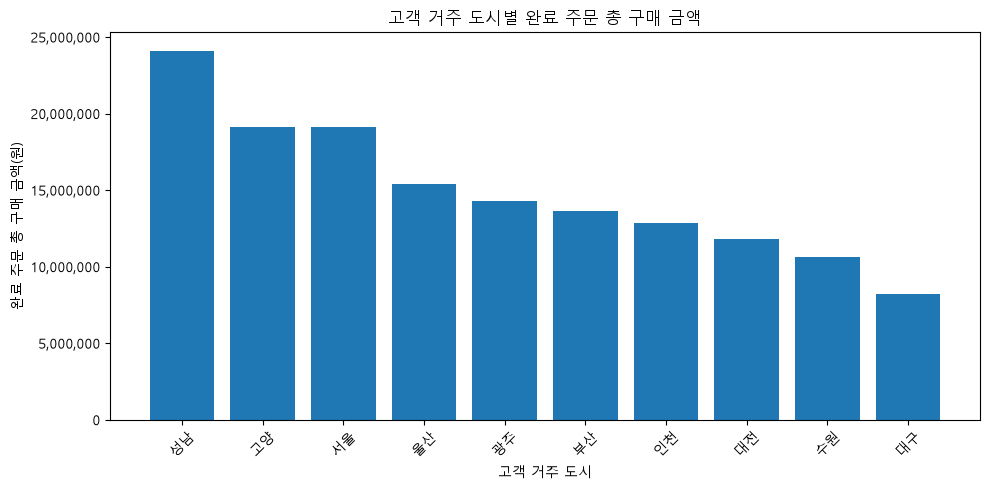
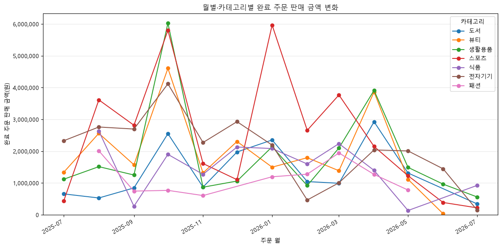
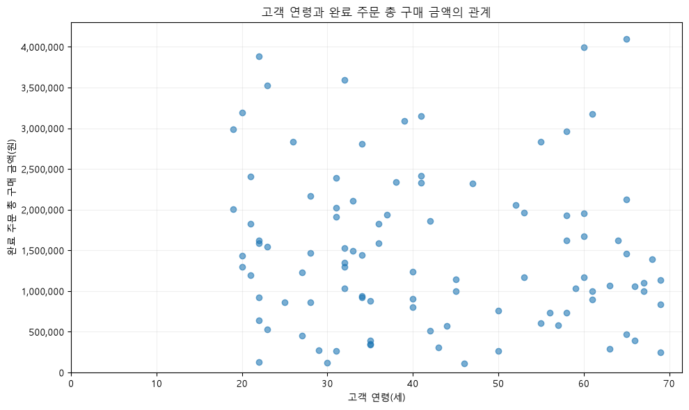

# Chapter 07 답안 양식. 그래프로 데이터의 이야기를 보여주기

> 이 내용을 `chapter07.ipynb`의 Markdown 셀로 작성합니다.

## 제출 정보
- 이름: 전해린
- GitHub ID: Haerin03
- 작성일: 2026.10.14
- 최종 Notebook URL: https://github.com/Haerin03/llm-data-analysis-study/blob/main/chapter07/chapter07.ipynb

## 1. 시각화 질문과 그래프 선택
| 질문 | 선택한 그래프 | 선택 이유 |
| --- | --- | --- |
| 고객 거주 도시별 completed 주문의 총 구매 금액은 어떻게 다른가? | 막대그래프 | 고객 거주 도시는 범주형 변수이므로 도시별 완료 주문 총 구매 금액의 크기를 비교하기에 막대그래프가 적합하다. |
| 월별·카테고리별 completed 주문 판매 금액은 어떻게 변화하는가? | 선그래프 | 월은 시간 순서가 있는 변수이므로 시간에 따른 판매 금액의 변화를 확인하기에 선그래프가 적합하다. 카테고리별 선을 함께 표시하면 카테고리별 변화 차이도 비교할 수 있다. |
| 고객 연령과 고객별 completed 주문 총 구매 금액 사이에는 어떤 관계가 있는가? | 산점도 | 고객 연령과 총 구매 금액은 모두 수치형 변수이므로 두 변수 사이에 나타나는 관계나 분포를 확인하기 위해 산점도가 적합하다. |

## 2. 대표 그래프 1

### 원본 집계값

고객 거주 도시별 completed 주문의 총 구매 금액을 집계한 결과, 성남이 24,099,000원으로 가장 높았고, 고양 19,116,000원, 서울 19,097,000원 순으로 나타났다. 반면 대구는 8,186,000원으로 가장 낮았다.
또한 원본 completed 주문 총액과 도시별 집계 금액의 합계를 비교한 결과 모두 148,990,000원으로 동일했으며, 집계 결과가 원본 데이터와 일치함을 확인하였다.

### 결과 관찰

도시별 완료 주문 총 구매 금액에는 비교적 뚜렷한 차이가 나타났다. 성남의 구매 금액이 가장 높았고, 고양과 서울이 비슷한 수준으로 그 뒤를 이었다. 대구의 구매 금액은 다른 도시와 비교해 가장 낮게 나타났다.
완료 주문 건수도 성남이 31건으로 가장 많았으며 서울은 29건이었다. 다만 고양은 완료 주문이 18건임에도 총 구매 금액이 19,116,000원으로 서울과 거의 비슷하게 나타났다.

### 나의 해석과 판단

도시별 총 구매 금액의 차이는 단순히 주문 건수만으로 설명되지는 않는 것으로 보인다. 예를 들어 고양은 서울보다 완료 주문 건수가 적지만 총 구매 금액은 거의 같은 수준이므로, 주문 1건당 구매 금액이나 구매한 상품의 가격 차이가 함께 영향을 주었을 가능성이 있다.
따라서 성남의 총 구매 금액이 가장 높다는 사실은 확인할 수 있지만, 이를 성남 고객의 구매 성향이나 구매력이 더 높다고 단정하기는 어렵다.

### 업무·분석적 의미

도시별 매출 기여 규모를 파악하면 지역별 고객 특성을 추가로 분석할 대상을 선정하는 데 활용할 수 있다. 특히 총 구매 금액뿐 아니라 주문 수와 평균 주문 금액을 함께 비교하면 지역별 구매 패턴의 차이를 보다 구체적으로 확인할 수 있다.

### 한계와 추가 확인 사항

현재 그래프는 도시별 총 구매 금액만 비교하므로 도시별 고객 수 차이, 주문당 평균 구매 금액, 고객 1인당 구매 금액을 반영하지 않는다. 따라서 도시별 고객수와 함께 완료 주문 건수, 평균 주문 금액, 고객 1인당 평균 구매 금액을 확인할 수 있을 것이다.

## 3. 대표 그래프 2

### 원본 집계값

2025년 7월부터 2026년 7월까지 월별·카테고리별 completed 주문 판매 금액을 집계하였다.
월별·카테고리별 집계 금액의 합계는 148,990,000원으로 원본 completed 주문 총액 148,990,000원과 동일하였다. 또한 월 정렬 여부는 True로 확인되었으며, 날짜 결측으로 월별 집계에서 제외된 완료 주문 상세 데이터는 0건이었다.

### 결과 관찰

카테고리별 판매 금액은 월마다 일정하게 증가하거나 감소하기보다는 변동하는 모습을 보였다.
특히 2025년 10월에는 생활용품과 스포츠 등의 카테고리 판매 금액이 크게 증가했으며, 2026년 1월에는 스포츠의 판매 금액이 약 600만 원 수준으로 크게 나타났다. 2026년 4월에는 뷰티와 생활용품의 판매 금액이 상대적으로 높게 나타났다.
반면 2026년 6월과 7월에는 여러 카테고리의 판매 금액이 이전 달보다 낮은 수준을 보였다.

### 나의 해석과 판단

전체 월별 판매 금액의 변화는 하나의 카테고리가 항상 주도하기보다는 시점에 따라 다른 카테고리의 판매 금액이 높아지면서 나타나는 것으로 보인다.
예를 들어 특정 월에는 스포츠가 높은 금액을 기록하고, 다른 월에는 생활용품이나 뷰티가 높은 금액을 기록하였다. 따라서 월별 전체 매출 변동을 이해하려면 전체 금액뿐 아니라 카테고리 구성도 함께 확인하는 것이 필요하다.
다만 이러한 변화가 계절성이나 프로모션 등의 영향 때문이라고 현재 데이터만으로 단정할 수는 없다.

### 업무·분석적 의미

월별 매출 변동이 어떤 카테고리와 함께 나타나는지를 확인하면 전체 매출 변화의 구성 요소를 파악할 수 있다. 특정 월에 크게 증가하거나 감소한 카테고리를 찾아 추가 분석 대상으로 선정하는 데 활용할 수 있다.
예를 들어 특정 카테고리의 판매 금액이 급증한 월을 대상으로 판매 수량, 주문 수, 평균 상품 가격 등을 함께 확인할 수 있다.

### 한계와 추가 확인 사항

현재 데이터에는 프로모션, 할인, 광고, 재고, 계절성 등의 정보가 없으므로 월별 변화의 원인을 직접 확인할 수 없다.
또한 특정 월·카테고리 조합이 그래프에 나타나지 않는 경우 실제 판매가 0이었던 것인지, 해당 조합의 데이터가 존재하지 않았던 것인지 구분하여 해석해야 한다. 따라서 월별&카테고리별 판매 수량, 주문 수, 평균 주문 금액, 특정 월의 판매 증가가 일부 상품에 집중되었는지 여부를 함께 확인하면 그래프 이해에 더욱 효과적일 것이다. 

## 4. 대표 그래프 3

### 원본 집계값

고객별 completed 주문 총 구매 금액을 집계한 뒤 고객 연령 정보를 결합하였다.
연령 결측 고객은 0명이었으며, 고객별 완료 주문 금액의 합계는 148,990,000원으로 원본 completed 주문 총액과 동일하게 나타났다.
고객별 구매 금액은 약 10만 원 수준부터 400만 원 이상까지 넓게 분포하고 있으며, 분석 대상 고객의 연령도 약 20세부터 69세까지 넓게 분포하였다.

### 결과 관찰

산점도에서 고객 연령과 완료 주문 총 구매 금액 사이에 뚜렷한 직선 형태의 관계는 보이지 않았다.
20대에서도 300만~390만 원 수준의 높은 구매 금액을 가진 고객이 존재했으며, 60대에서도 400만 원 이상을 구매한 고객과 100만 원 이하를 구매한 고객이 함께 나타났다.
즉, 비슷한 연령에서도 고객별 총 구매 금액의 차이가 크게 나타났다.

### 나의 해석과 판단

현재 산점도만 보면 연령이 높아질수록 구매 금액이 일정하게 증가하거나 감소한다고 보기는 어렵다.
동일한 연령대에서도 구매 금액의 편차가 크기 때문에 고객의 구매 금액은 연령 외에도 주문 횟수, 주문당 구매 금액, 구매 상품의 가격 및 카테고리 등 여러 요인의 영향을 받을 가능성이 있다.
따라서 연령이 구매 금액의 직접적인 원인이라고 판단해서는 안 된다.

### 업무·분석적 의미

연령만으로 고객의 구매 규모를 구분하기에는 한계가 있다는 점을 확인할 수 있다. 따라서 고객 세분화나 구매 패턴 분석에서는 연령 단독 기준보다는 주문 빈도, 평균 주문 금액, 총 구매 금액 등의 행동 지표를 함께 활용하는 것이 더 적절할 수 있다.

### 한계와 추가 확인 사항

현재 그래프에서는 고객별 누적 구매 기간이나 가입 시점이 고려되지 않았다. 오래 가입한 고객은 자연스럽게 누적 구매 금액이 높아질 가능성이 있으므로 단순 누적 금액만으로 비교하는 데 한계가 있다.
또한 주문 횟수와 평균 주문 금액을 분리해서 보지 않았기 때문에 높은 구매 금액이 반복 주문 때문인지 일부 고액 주문 때문인지 알 수 없다. 
따라서 연령과 완료 주문 횟수나 평균 주문 금액 간의 관계를 확인하거나 연령대별 고객 수, 고객 가입 기간을 고려한 구매 금액, 연령대별 구매 카테고리 차이를 함께 해석할 수 있다. 

## 5. 그래프 정확성 점검
- [O] 그래프 값과 집계표 값 일치
- [O] 축 이름 확인
- [O] 단위 확인
- [O] 범례 확인
- [O] 날짜 정렬 확인
- [O] 과장될 수 있는 축 범위 확인
- [O] 제목이 분석 범위를 정확히 표현

### 내가 발견한 시각화 위험 또는 개선점

첫 번째 막대그래프는 금액 축이 0부터 시작하므로 도시 간 차이를 과도하게 확대하지 않고 있으며, 완료 주문 금액 기준으로 내림차순 정렬되어 있어 비교가 쉽다. 다만 도시별 고객 수가 서로 다르기 때문에 총 구매 금액만으로 도시별 고객의 구매 성향을 비교하면 오해가 발생할 수 있다.
두 번째 선그래프는 7개 카테고리의 선을 한 그래프에 표시하고 있어 일부 구간에서는 선이 겹쳐 가독성이 떨어질 수 있다. 카테고리 수가 많아질 경우 주요 카테고리만 표시하거나 카테고리별 그래프를 분리하는 방법도 고려할 수 있다. 또한 데이터가 없는 월·카테고리 조합을 자동으로 0으로 처리하지 않았다는 점을 해석할 때 주의해야 한다.
세 번째 산점도는 연령과 구매 금액의 전체 분포를 확인하기에는 적절하지만, 같은 연령의 고객이 겹쳐 표시될 수 있고 고객별 주문 횟수 차이가 그래프에 직접 나타나지 않는다. 향후 주문 횟수를 추가 변수로 활용하거나 연령대별 분포를 추가로 비교하면 해석을 보완할 수 있다.
세 그래프 모두 completed 주문 금액을 사용하는 경우 원본 총액과 집계 총액이 148,990,000원으로 일치함을 확인한 뒤 시각화를 진행하였다.

## 6. Chapter 07 최종 판단
### 가장 중요한 그래프 1개와 이유

세 그래프 중 월별·카테고리별 완료 주문 판매 금액 변화 그래프가 가장 중요하다고 판단하였다.
이 그래프는 전체 매출의 시간적 변화뿐 아니라 월별 변화가 어떤 카테고리와 함께 나타나는지를 동시에 확인할 수 있기 때문이다. 단순 월별 총액 그래프보다 매출 변화의 구성을 한 단계 더 구체적으로 살펴볼 수 있다는 장점이 있다.

### 그래프가 보여 준 사실

카테고리별 판매 금액은 분석 기간 동안 일정한 방향으로 증가하거나 감소하지 않고 월마다 변동하였다.
특정 카테고리가 분석 기간 전체에서 항상 가장 높은 판매 금액을 기록한 것은 아니었으며, 시점에 따라 스포츠, 생활용품, 뷰티 등 서로 다른 카테고리의 판매 금액이 크게 나타났다.
따라서 월별 전체 판매 금액 변화에는 카테고리별 판매 구성의 변화가 함께 나타나고 있음을 확인할 수 있었다.

### 그래프만으로 말할 수 없는 것

그래프만으로는 특정 월 또는 카테고리의 판매 금액이 증가하거나 감소한 원인을 확인할 수 없다.
프로모션, 할인, 계절성, 광고, 재고 변화, 신상품 출시와 같은 정보가 현재 데이터에 포함되어 있지 않기 때문에 이러한 요인을 원인으로 단정할 수 없다.
또한 판매 금액이 높은 것이 판매 수량이 많았기 때문인지, 고가 상품이 많이 판매되었기 때문인지도 금액 그래프만으로는 알 수 없다.

### 다음 분석에서 확인할 질문

'월별·카테고리별 판매 금액 변화는 판매 수량과 주문 건수의 변화와 어떻게 연결되는가?'
이를 위해 월별·카테고리별 판매 수량, 주문 수, 평균 주문 금액을 함께 비교하면 특정 기간의 판매 금액 변화가 주문 증가 때문인지, 판매 수량 증가 때문인지, 혹은 고가 상품 판매 때문인지 보다 구체적으로 분석할 수 있다.

## 최종 체크
- [O] 그래프와 수치를 교차 검증했습니다.
- [O] 관찰과 해석을 구분했습니다.
- [O] 업무적 의미와 한계를 작성했습니다.
- [O] 최종 Notebook URL을 제출합니다.